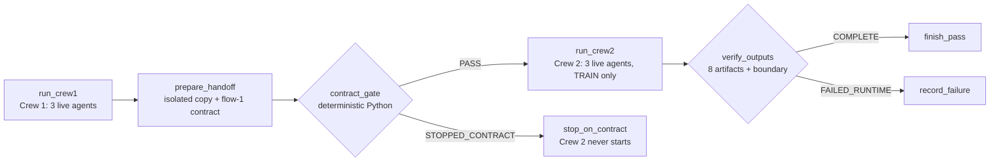

# Academic evidence report: a verified end-to-end live-LLM CrewAI Flow

> **ALL DATA IS SYNTHETIC.** Every record is produced by the seeded simulation in `generator/` (seed 42). The live
> run sent only synthetic data, statistics and tool results to the model provider. Nothing here is evidence of
> real-world predictive accuracy.

**Thesis.** *Production Suite Budget AI combines the flexibility of multi-agent AI with the reliability of
deterministic contract validation — demonstrated through a genuine, verified end-to-end LLM execution.*

This report documents the live run `p5-live-001` (2026-10-28): the complete CrewAI Flow, Crew 1 → deterministic
contract gate → Crew 2, with all six agents answered by the Anthropic API. Every number below is taken from the
committed evidence in [`flow_evidence/live/p5-live-001/`](../flow_evidence/live/p5-live-001/) and can be checked
without an API key (section 8).

## 1. Summary

| | result |
|---|---|
| Flow status | `PASS` (exit 0, no error) |
| Agents with live responses | 6 of 6 (3 in Crew 1, 3 in Crew 2) |
| Provider calls | 32, all HTTP 200, each with a provider `request-id` and message id; 0 scripted responses |
| Model | `claude-haiku-4-5-20251001` (requested and reported by the provider in all 32 responses), temperature 0 |
| Contract gate | `PASS` (contract `flow-1`, 0 violations), decided at 09:27:28.526 UTC |
| Crew 2 | started 09:27:28.529 UTC, after the gate decision; first provider call 09:27:30.479 UTC |
| Required artifacts | 8 of 8 present, sha256-verified |
| Model selected | logistic regression, `C = 10`, by the pre-registered rule; reproduction of the approved P4 run exact |
| TEST set | sealed, opened 0 times |
| Tokens | 204,348 input, 23,204 output |
| Estimated API cost | about USD 0.30 (USD 0.2984; section 5.6) |
| Wall-clock time | 520 s (8 min 40 s) |
| Evidence verifier | `VERDICT: PASS (10/10 checks)` |
| Offline regression suite | 574 passed, 2 skipped, 0 failed (section 7) |

## 2. Three kinds of run, kept apart

| | P3 live Crew 1 | P5 scripted Flow (canonical) | P5 live Flow |
|---|---|---|---|
| Evidence | `artifacts/crew1/p3-live-005/` | `flow_evidence/runs/p5e-run-001/` | `flow_evidence/live/p5-live-001/` |
| Date | 2026-10-19 | 2026-10-20 | 2026-10-28 |
| What ran | Crew 1 alone (`python -m crew1.run --live`) | the complete Flow | the complete Flow |
| Model responses | live Anthropic | scripted in-process transport, marked `[SCRIPTED RESPONSE - not LLM inference]`; no network | live Anthropic |
| Agents with live responses | 3 | 0 | 6 |
| Flow contract gate and Crew 2 | no | yes | yes |
| Model requests | 18 | 37 scripted exchanges (14 + 23) | 32 provider calls (20 + 12) |
| Tokens / estimated cost | 138,863 / USD 0.19 | 0 / USD 0 | 227,552 / USD 0.30 |
| Per-call provider record | no (totals only) | not applicable | yes |
| Verified by | P3 validators V1–V9 | app evidence check, `tests/test_flow_e2e.py` | `orchestrator/verify_live_run.py` L1–L10 |
| Purpose | approve Crew 1's handoff | byte-reproducible regression baseline and five deliberate contract breaks | demonstrate the complete Flow with genuine LLM agents |

The scripted mode remains the default because it makes the regression tests reproducible byte for byte; the live
mode demonstrates that the same orchestration works with genuine model inference.

## 3. Architecture



The Flow (`orchestrator/flow.py`, `crewai.flow.flow.Flow`) uses `@start`, `@listen` and two `@router` methods.
Crew 2 is a listener of the route `"PASS"` only, and `run_crew2` additionally refuses to start unless the recorded
gate decision is `PASS`. Crew 2 reads only the Flow's copy of the handoff; a runtime guard refuses any read of the
raw export, of Crew 1's code or of Crew 1's output folder while Crew 2 runs.

**The six agents** (one LLM instance each; each agent sees only its own tools; every tool is deterministic Python):

| crew | agent | task | tools | live calls | input / output tokens | active (UTC) |
|---|---|---|---|---|---|---|
| 1 | Data Ingestion & Cleaning Engineer | `ingest_and_clean` | `load_raw_table`, `detect_defects`, `apply_policy_c`, `eligibility_summary` | 5 | 19,667 / 1,106 | 09:22:54–09:23:13 |
| 1 | Exploratory Data Analyst | `explore_and_report` | `list_analyses`, `run_analysis`, `render_chart`, `assemble_eda_report` | 9 | 104,999 / 13,018 | 09:23:13–09:26:13 |
| 1 | Data Contract & Insights Author | `contract_and_insights` | `build_dataset_contract`, `run_handoff_gate`, `write_insights` | 6 | 42,707 / 5,076 | 09:26:13–09:27:28 |
| 2 | Handoff & Feature Validator | `validate_handoff_and_features` | `validate_handoff`, `write_features` | 2 | 2,183 / 411 | 09:27:30–09:27:47 |
| 2 | TRAIN-only Model Trainer | `train_select_and_fit` | `check_preregistration`, `list_runs`, `run_grouped_cv`, `apply_selection_rule`, `fit_final_models`, `verify_reproducibility` | 7 | 24,163 / 2,578 | 09:27:47–09:31:07 |
| 2 | Evaluation & Ethics Author | `write_and_verify_artifacts` | `write_model`, `write_evaluation_report`, `write_model_card`, `verify_artifacts` | 3 | 10,629 / 1,015 | 09:31:07–09:31:31 |

The division of labour is deliberate: **the agents decide which tools to call, in what order, and write the
interpretive text; the tools compute every number, transformation, contract field, model fit and check.**

## 4. Method: live mode and its evidence

- **Same code path, different responses.** `--llm live` changes only where the model responses come from. In the
  default mode `crew_common/scripted.py` answers at the httpx transport layer; in live mode
  `crew_common/live.py` (`RecordingTransport`) sits at the same layer, forwards each request unchanged to
  `api.anthropic.com` and refuses any other host. The scripted transport is never installed in live mode: there is
  no fallback, and a provider error fails the run.
- **Provider record, sanitized.** For each call: UTC start and end, crew and agent, HTTP status, the provider's
  `request-id` header, message id, reported model, stop reason, token usage, the names of the tools requested, and a
  sha256 digest of the request body. No header, no body and no key is recorded. The API key is read only by the
  Anthropic SDK from the environment.
- **Controls.** One budget for the whole Flow (at most 150 requests including SDK retries, 2,000,000 input and
  150,000 output tokens; a request over budget is refused before it is sent), 8,192 output tokens per response,
  temperature 0, 2 SDK retries, 20 requests per minute, per-agent turn limits, no task retries.
- **Fail-closed checks inside the run.** A crew fails if any agent received no live response, if a non-provider
  host was contacted, if Crew 1's own handoff gate did not pass, or if Crew 2's artifact checks fail.
- **Evidence package.** `flow_evidence/live/p5-live-001/` is a byte-for-byte copy of all 23 files of the run folder,
  plus `evidence.json` with the sha256 of each file. The original run folder was not modified.
- **Independent verifier.** `orchestrator/verify_live_run.py` uses the Python standard library only (no CrewAI, no
  project import beyond its package, no network, no key) and checks the evidence from the files alone (section 5.7).

## 5. Results of `p5-live-001`

### 5.1 Provider evidence

32 provider calls, all HTTP 200, 0 retries, 0 refused by the budget, 0 non-provider hosts. Every call carries a
provider `request-id` (`req_…`), a message id (`msg_…`) and non-zero token usage, and reports the model
`claude-haiku-4-5-20251001`. Records: `crew1/crew_kickoff.json` and `crew2/crew_kickoff.json`,
`llm_transport.exchanges`. CrewAI's own event bus independently counted 20 and 12 LLM calls, 3 agents executed
and 3 tasks completed in each crew.

The trainer needed only 7 calls for 14 tool executions because the model requested all nine pre-registered
grouped-CV runs in a single response (parallel tool use); all nine executed.

### 5.2 Execution chronology (UTC, 2026-10-28)

| time | event | source |
|---|---|---|
| 09:22:52.479 | Flow started; `run_crew1` started | `flow_events.jsonl` |
| 09:22:54.293 | first Crew 1 provider call | `crew1/crew_kickoff.json` |
| 09:27:28.220 | last Crew 1 provider call finished | `crew1/crew_kickoff.json` |
| 09:27:28.396 | `run_crew1` finished; `prepare_handoff` started | `flow_events.jsonl` |
| 09:27:28.443 | handoff copy and `flow-1` contract ready; `contract_gate` started | `flow_events.jsonl` |
| **09:27:28.526** | **gate decision `PASS`, 0 violations** | `flow_manifest.json` `timing.utc.gate_decided` |
| 09:27:28.529 | `contract_gate` finished with route `PASS`; `run_crew2` started | `flow_events.jsonl` |
| 09:27:30.479 | first Crew 2 provider call | `crew2/crew_kickoff.json` |
| 09:31:31.322 | last Crew 2 provider call finished | `crew2/crew_kickoff.json` |
| 09:31:31.485 | `verify_outputs` → `COMPLETE` (8 of 8 outputs) | `flow_events.jsonl` |
| 09:31:31.490 | Flow finished, status `PASS` | `flow_events.jsonl` |

Every Crew 1 call finished before the gate decided, and every Crew 2 call started after it (verifier check L8).
Durations: Crew 1 276 s, handoff and gate 0.1 s, Crew 2 243 s, total 520 s.

### 5.3 Contract gate

`handoff/gate_report.json`: contract `flow-1`, decision `PASS`, 0 violations, computed on exactly the files in
`handoff/` (`clean_data.csv` `2b8353247ebd…`, `dataset_contract.json` `d8774b8dd55b…`, `flow_contract.json`
`67121c4f09e0…`). Crew 1's own P2 handoff gate, run inside Crew 1 by its contract author, also passed (22 checks).

### 5.4 The eight required artifacts and their integrity

| artifact | sha256 (prefix) | equal to the scripted canonical run? |
|---|---|---|
| `crew1/clean_data.csv` | `2b8353247ebd…` | yes, byte-identical |
| `crew1/eda_report.html` | `6356f666386f…` | no: narrative written by the live model |
| `crew1/insights.md` | `f7a33d098332…` | no: narrative written by the live model |
| `crew1/dataset_contract.json` | `d8774b8dd55b…` | no: column descriptions differ (5.4.1) |
| `crew2/features.csv` | `a0ec48bd4525…` | yes, byte-identical |
| `crew2/model.joblib` | `053cb987dfef…` | yes, byte-identical |
| `crew2/evaluation_report.md` | `161c1c3f0d2e…` | differs only in the input digests it cites |
| `crew2/model_card.md` | `39c21e11e845…` | yes, byte-identical |

The full sha256 values are in `flow_manifest.json` (`required_outputs_sha256`) and `evidence.json`; the verifier
recomputes them (L4). The frozen P3 Crew 1 validators, run offline on a copy of this run's Crew 1 outputs, pass
V1–V7 and V9 (V8 concerns a P3-format manifest, which the Flow does not write): the cleaned data equals a fresh
Policy C recomputation, the contract structure equals a fresh build, and every quantitative claim in the
model-written EDA report and insights matches the computed statistics.

#### 5.4.1 What the model wrote, and what the code rejected

Two events in the trace (`crew1/trace.jsonl`) show the deterministic checks constraining the live model:

1. The Exploratory Data Analyst submitted the EDA report five times. Each time `assemble_eda_report` listed the
   quantitative claims it could not verify against the computed statistics: 5, then 3, 3, 2 and finally 0. Only the
   fully verified version remains.
2. The Contract Author's first `build_dataset_contract` call described a column that does not exist
   (`snapshot_id`). The code rejected it (`ContractError: unknown column in descriptions`), and its premature
   `run_handoff_gate` call was refused because no contract existed yet. These are Crew 1's 2 rejected tool calls.
   The second call supplied no descriptions, so every field of the delivered contract was computed by Python; it is
   byte-identical to the P3 live run's contract, while the scripted run supplies one description.

### 5.5 Model selection and evaluation

Crew 2 ran the nine pre-registered grouped-CV runs on TRAIN only (1,084 rows, 278 productions; 5 frozen
production-grouped folds; seed 42). Primary comparison (`is_overrun`, 27 features), mean ± sd over folds:

| candidate | Brier | PR-AUC | ROC-AUC |
|---|---|---|---|
| B0 (baseline) | 0.2069 ± 0.0142 | 0.6579 ± 0.0452 | 0.7071 ± 0.0385 |
| **LR** | **0.1884 ± 0.0147** | 0.7570 ± 0.0779 | 0.7891 ± 0.0414 |
| GB | 0.1992 ± 0.0055 | 0.7321 ± 0.0517 | 0.7624 ± 0.0152 |

The rule, applied by code and not by an agent, selected LR (`C = 10`) by the lowest mean Brier. The CV results,
selection, parameters, predictions and both model hashes equal the approved P4 run exactly. TEST was not reopened
(vault sealed, 0 opens); the historical P4 TEST result is cited, not recomputed: Brier 0.1751 [0.1471, 0.2045],
PR-AUC 0.8880 [0.8176, 0.9406], ROC-AUC 0.8385 (306 rows, 80 productions). Because the final models are
byte-identical to the P4 models, that result applies to them.

### 5.6 Token usage and estimated cost

| | tokens | catalogue price (USD per million) | USD |
|---|---|---|---|
| input, uncached | 173,382 | 1.00 | 0.1734 |
| input, cache write | 5,161 | 1.25 | 0.0065 |
| input, cache read | 25,805 | 0.10 | 0.0026 |
| output | 23,204 | 5.00 | 0.1160 |
| **total** | **227,552** | | **0.2984** (exact; the rounded parts add to 0.2985) |

The estimate applies the price catalogue bundled with the pinned `crewai` to this run's recorded token counts. It
is an estimate for this run, not an itemized provider charge; the provider's console aggregates all use of a
workspace.

### 5.7 Evidence verification

`python -m orchestrator.verify_live_run flow_evidence/live/p5-live-001` → **`VERDICT: PASS (10/10 checks)`**.

| check | result |
|---|---|
| L1 Flow `PASS` in live mode | PASS |
| L2 routing Crew 1 → gate `PASS` → Crew 2 → `COMPLETE` | PASS |
| L3 deterministic gate `PASS`, 0 violations, on the files in `handoff/`, no deliberate break | PASS |
| L4 all 8 required outputs present and sha256-verified | PASS |
| L5 every exchange a recorded live Anthropic call | PASS (32: Crew 1 20, Crew 2 12) |
| L6 each of the six agents got live responses | PASS (5, 9, 6, 2, 7, 3) |
| L7 no scripted response anywhere | PASS |
| L8 Crew 2 began only after the gate returned `PASS` | PASS |
| L9 manifest totals equal the recorded exchanges | PASS |
| L10 no API key in the evidence | PASS |

## 6. Why the deterministic contract gate is essential

LLM agents are flexible: in this run they chose their own tool order, batched tool calls, revised their reports and
recovered from rejected calls. The same flexibility makes their output variable, and a downstream model trained
on a silently corrupted handoff would fail without any error. The contract gate turns the handoff between the crews
into a checked interface: Crew 2 starts only on an explicit, complete, violation-free `PASS`, and anything else
(a violation, a missing file, an exception inside the gate) stops the run before any training.

**Successful path (live).** `p5-live-001`: gate `PASS` with 0 violations, then Crew 2, then 8 of 8 artifacts.

**Rejection paths (tested).** Five deliberate breaks of a real Crew 1 handoff, each applied to the Flow's isolated
copy, committed under `flow_evidence/runs/` and re-run by `tests/test_flow_e2e.py`:

| scenario | what was changed | violation codes | status (exit) | Crew 2 |
|---|---|---|---|---|
| `column_rename` | a column renamed | `COLUMN_SET_MISMATCH`, `CONTENT_DIGEST_MISMATCH`, `PROFILE_DECLARATION_MISMATCH`, `UNIT_SCALE_ANOMALY` | `STOPPED_CONTRACT` (3) | never started |
| `money_x100` | money ×100, with a matching contract regenerated by the "attacker" | `UNIT_SCALE_ANOMALY` | `STOPPED_CONTRACT` (3) | never started |
| `row_deletion` | a required snapshot row deleted | `CONTENT_DIGEST_MISMATCH`, `PROFILE_DECLARATION_MISMATCH`, `ROW_COUNT_MISMATCH` | `STOPPED_CONTRACT` (3) | never started |
| `contract_column_deletion` | a column definition deleted from the contract | `BASE_CONTRACT_COLUMNS`, `BASE_CONTRACT_DIGEST_MISMATCH` | `STOPPED_CONTRACT` (3) | never started |
| `label_leakage` | an outcome label leaked as an input column | `BASE_CONTRACT_COLUMNS`, `BASE_CONTRACT_DIGEST_MISMATCH`, `COLUMN_SET_MISMATCH`, `CONTENT_DIGEST_MISMATCH` | `STOPPED_CONTRACT` (3) | never started |

In every break, Crew 2's kickoff, every grouped-CV run and every model fit were called 0 times, and no Crew 2
output exists. Offline tests also cover the live path: a `money_x100` break in live mode stops at the gate with no
Crew 2 provider call; an exhausted request budget fails the run before Crew 2; a gate exception fails closed
(`GATE_EXCEPTION`); and a Crew 1 or Crew 2 runtime error is `FAILED_RUNTIME`, never `PASS`.

The same principle operates inside Crew 1 (section 5.4.1): the model may propose text and numbers, but code
decides what is accepted.

## 7. Regression and publication checks

- **Offline regression suite** (`pytest`, no key, no network): 574 passed, 2 skipped (expected on Windows without
  symlink rights and without a local-only P3 audit record), 0 failed. It includes the scripted Flow end to end,
  the five contract breaks, and the live mode end to end with an in-process stand-in for the provider placed behind
  the recording transport (`tests/test_flow_live.py`). On that stand-in the verifier passes every check except L5,
  which correctly rejects its offline identifiers; a scripted run fails L1, L5 and L7.
- **Committed evidence tests:** the verifier returns 10/10 on `flow_evidence/live/p5-live-001`, and
  `evidence.json` matches every file.
- **Security:** the pre-publication scan (detect-secrets and content rules, with the owner's private denylist) finds
  0 secret and 0 content findings in the publication set and in the history. The 97 sha256 provenance digests in
  the live evidence are spared only by a narrow, owner-approved exemption (exact paths, unchanged files by git blob
  id, digest-only lines; `docs/security_scan.md`). The publication dry run on a disposable clone passed.

## 8. Reproducibility

**Without an API key** (checks the committed evidence):

```
python -m orchestrator.verify_live_run flow_evidence/live/p5-live-001
```

**With a key** (a new live run): follow the README section
[Run the Complete Flow with a Live LLM](../README.md#run-the-complete-flow-with-a-live-llm): a fresh clone,
Python 3.13, `pip install -r requirements-ml.txt` (pinned versions), the key in `ANTHROPIC_API_KEY` for the
terminal session only, then

```
python -m orchestrator.flow --llm live --out out/flow_runs/live-001 --n-jobs 5
python -m orchestrator.verify_live_run out/flow_runs/live-001
```

**What a new run will and will not reproduce.** Model output varies between runs even at temperature 0: the number
of calls, the tokens, the cost, the timing and the narrative texts will differ. The cleaned data, features,
contract checks, model selection, fitted models and model card are computed by code and are expected to be
identical; the reproduction check against the approved P4 run is exact in the pinned Windows environment and uses
pre-registered tolerances elsewhere. A new run can also fail (for example, if the model exhausts an agent's turn
limit); it then ends `FAILED_RUNTIME` and is never reported as `PASS`.

## 9. Limitations

- **Synthetic data.** The results demonstrate a workflow and its controls, not predictive accuracy on real
  productions.
- **One documented live run.** The live results describe `p5-live-001`; they are not a statistical sample of live
  behaviour. Variation between live runs is expected and was not measured systematically.
- **Bounded agent autonomy.** By design the agents cannot change data or numbers; the model choice and selection are
  code. The demonstration shows that genuine LLM agents can operate the pipeline under deterministic control, not
  that they make modelling decisions.
- **One provider and model.** Only `claude-haiku-4-5-20251001` through CrewAI's native Anthropic provider was used.
- **What the verifier can prove.** It proves the internal consistency of the evidence, the ordering and the absence
  of scripted responses. It cannot prove by itself that files were not fabricated; independent confirmation comes
  from the provider's request ids and console, and from a new run by another person.
- **Cost is an estimate** from a bundled price catalogue, not a provider invoice.
- **Narrative quality** is checked for unverifiable numbers and forbidden claims, not judged by human raters.
- **Historical TEST metrics** come from P4 and were deliberately not recomputed; TEST stayed sealed.
- **Environment.** The exact reproduction mode applies to the pinned Windows environment; other platforms use
  pre-registered tolerances.

## 10. Evidence index

| path | content |
|---|---|
| `flow_evidence/live/p5-live-001/flow_manifest.json` | status, routes, gate, `llm` block (calls, usage, cost, budget), `timing.utc` |
| `flow_evidence/live/p5-live-001/flow_events.jsonl` | CrewAI Flow events with UTC times |
| `flow_evidence/live/p5-live-001/handoff/gate_report.json` | the contract gate decision |
| `flow_evidence/live/p5-live-001/crew1/crew_kickoff.json`, `crew2/crew_kickoff.json` | per-call provider records, CrewAI events, tool calls |
| `flow_evidence/live/p5-live-001/crew1/trace.jsonl`, `crew2/trace.jsonl` | redacted tool-call traces |
| `flow_evidence/live/p5-live-001/evidence.json` | sha256 of every file in the package |
| `flow_evidence/runs/` | the scripted canonical run and the five contract breaks |
| `artifacts/crew1/p3-live-005/` | the P3 live run of Crew 1 alone |
| `crew_common/live.py`, `orchestrator/flow.py`, `orchestrator/verify_live_run.py` | live mode and verifier |
| `tests/test_flow_live.py`, `tests/test_publish_scan_live.py` | offline tests of the live path and the evidence |
| [`docs/live_run.md`](live_run.md), [`docs/flow.md`](flow.md), [`docs/security_scan.md`](security_scan.md) | operating detail, Flow design, security |
